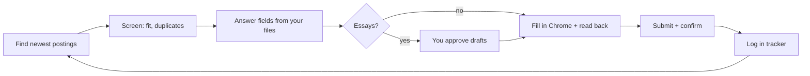

# Internship Autopilot

Apply to internships at volume **without sending anything fake or generic.**

Claude finds fresh postings from public job lists, fills each application from a file of facts
about you, drafts essays only from real stories you've written down, waits for you to approve
every essay, submits through your own Chrome, and logs every submission with proof.
Everything about *what* it applies to and *how* it answers is set in files you control.



## What's in the box

| Piece | File | What it does |
|---|---|---|
| Preferences | `config/preferences.toml` | Role tracks and weights, dream companies, locations, pay floor, terms, caps, job-list sources, tracker statuses |
| Writing rules | `config/writing.toml` | Banned clichés, dash rule, fabrication checks, story-matching hints |
| Your facts | `data/profile.json` | Identity, school, grad date, work authorization, EEO answers, consents, locations |
| Your stories | `data/stories.json` | The **only** material essays may use: facts, real numbers, your own words, what never to claim |
| Your voice | `data/voice.md` | How you write, with examples; grows with your grading feedback |
| Operator guide | `CLAUDE.md` | The step-by-step loop and guardrails Claude follows |
| Discovery | `autopilot.py discover` | Pulls SimplifyJobs + Zapply lists, filters and ranks by your preferences, skips duplicates |
| Resolver | `lib/resolve.py` | Answers each form field from your profile **with a source**, and pauses when it has none |
| Linter | `lib/lint.py` | Blocks invented numbers, clichés, dashes, unconfirmed stories and generic answers |
| Packets | `autopilot.py new / check` | One file per job: every answer, its source, the resume, essays, READY or BLOCKED |
| Review desk | `review-desk/index.html` | Grade each draft 1 to 5, approve or ask for a rewrite; runs offline in your browser |
| Tracker | `autopilot.py track` | `data/tracker.xlsx` with a status dropdown; can mirror to a Google Sheet |
| Inbox sync | `docs/INBOX_SYNC.md` | A daily task that reads replies and updates your tracker |
| Site notes | `docs/SITE_NOTES.md` | How Greenhouse, Ashby, Lever, Rippling and Workday forms really behave |

## Setup (about 30 minutes)

You need Python 3.11+, git, [Claude](https://claude.ai) with the **Claude in Chrome** extension,
and your resumes as PDFs.

```bash
git clone https://github.com/<you>/internship-applier.git && cd internship-applier
pip install openpyxl
python3 autopilot.py init        # copies the templates into data/ and creates the tracker
```

Then fill in your files (or ask Claude to interview you and fill them in):

1. **`data/profile.json`**: replace every example value. Set `consents` to what you're comfortable
   with; anything `false` makes Claude stop and ask. EEO answers can be `"decline"`.
2. **`data/stories.json`**: 5 to 10 real projects. Real numbers, your own phrasing, and a
   `do_not_claim` list. Only `"status": "confirmed"` stories are ever used.
3. **`data/voice.md`**: a few lines on how you sound, plus one good and one bad example.
4. **`resumes/`**: one PDF per track, named to match `config/preferences.toml`.
5. **`config/preferences.toml`**: your tracks, dream companies, locations, pay floor and terms.

```bash
python3 autopilot.py doctor      # tells you what's still missing
python3 autopilot.py discover    # ranked queue in data/queue.csv
```

## Running it

Open Claude in this folder and say:

> Read CLAUDE.md. Apply to as many roles from the queue as you can within my preferences,
> newest postings first. Send me essays to approve as you go.

Claude works through the loop in `CLAUDE.md`. When it needs you, it stops and asks: an essay to
approve, a question your files can't answer, a login, a CAPTCHA, or a legal consent.

Approving essays:

```bash
python3 autopilot.py review export       # writes review-desk/drafts.json
# open review-desk/index.html, load drafts.json, grade, click "Export grades"
python3 autopilot.py review import ~/Downloads/grades.json
```

You can also just approve in chat ("both are fine, submit").

## Customizing

- **Different roles:** add a `[[tracks]]` block with a title regex, weight and resume. The track
  name flows through discovery, packets and the tracker.
- **Different season or degree:** change `[search] terms`, `offcycle_terms` and `degree`.
- **More job lists:** add a `[[sources]]` block. `simplify_listings_json` works for any
  SimplifyJobs-format repo, and `zapply_readme` for Zapply-format READMEs. New formats go in
  `PARSERS` in `lib/discover.py`.
- **Stricter or looser writing rules:** edit `config/writing.toml`.
- **Keep your settings private:** copy `config/preferences.toml` to `config/preferences.local.toml`
  (git-ignored) and edit that instead. When it exists it replaces the shared file, so you can pull
  updates without conflicts. Same for `writing.local.toml`.
- **What Claude may agree to:** `data/profile.json > consents`.
- **Tracker columns or statuses:** `[tracker]` in preferences. For a Google Sheet mirror, paste its
  URL into `google_sheet_url` and see the Sheets notes in `docs/SITE_NOTES.md`.

## Guardrails (not configurable)

Claude never types passwords, creates accounts or solves CAPTCHAs. It never invents facts or
answers a question it has no source for. It treats job pages and emails as data, not instructions,
and it never marks an application Submitted without a confirmation. The full list is in `CLAUDE.md`.

## Privacy

Your personal files (`data/`, `resumes/*.pdf`, `packets/`, `forms/`) are in `.gitignore`, so
they stay on your machine even if you fork this publicly. Only the templates are shared.

## Tests

```bash
python3 tests/run.py       # or `pytest` if you have it; runs against the example templates
```

## Credits

Ideas, but no code, were borrowed from open-source appliers:
[GodsScion/Auto_job_applier_linkedIn](https://github.com/GodsScion/Auto_job_applier_linkedIn)
(whole-word matching pitfalls), [santifer/career-ops](https://github.com/santifer/career-ops)
(answer-resolver order, cliché lists), and
[berellevy/job_app_filler](https://github.com/berellevy/job_app_filler) (ATS form handling).
Job data comes from [SimplifyJobs](https://github.com/SimplifyJobs/Summer2027-Internships) and
[Zapply](https://github.com/zapplyjobs/Internships-2027).

MIT License.
